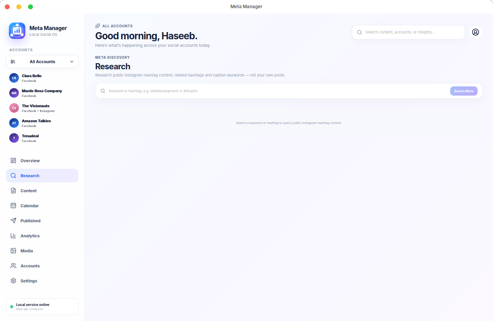
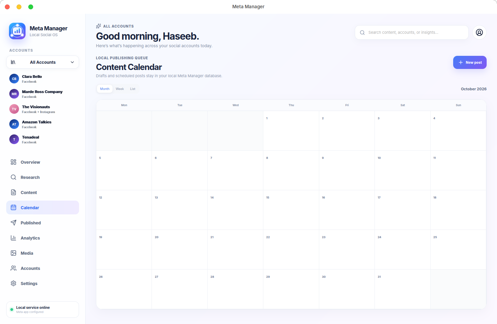
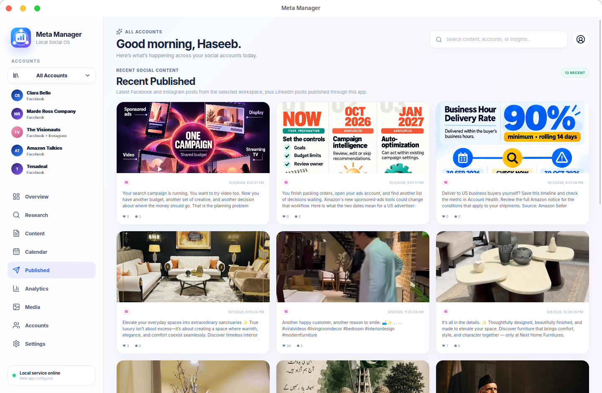
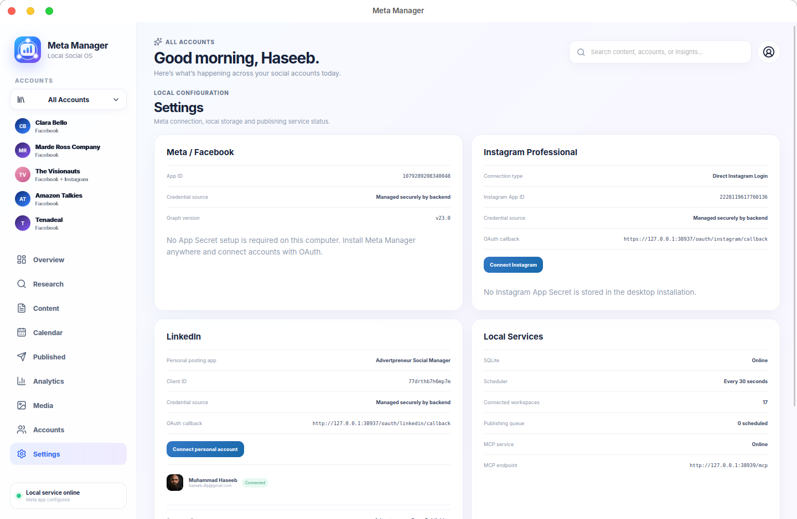

# Meta Manager

**A local-first desktop social manager for Facebook, Instagram, and LinkedIn.**

Meta Manager brings account connections, publishing, scheduling, media, analytics, and research into one desktop workspace. It is built with **Tauri + React + Rust**, keeps social account tokens on the user's machine, and uses a small secure OAuth broker so new installations never need provider App Secrets.

> Current public release: **v0.1.11** — Linux + Windows. **v0.1.13** is an unreleased media-hosting / MCP proxy development build.
>
> Product page: **https://advertpreneur.com/meta-manager/**
>
> Release: **https://github.com/haseebgb92/meta-manager/releases/tag/v0.1.11**



## What it does

- Connect multiple **Facebook Pages**
- Connect **Instagram Professional** accounts directly with Instagram Login
- Discover Instagram Professional accounts linked to Facebook Pages
- Connect multiple **LinkedIn personal profiles**
- Publish and schedule social content from one calendar
- Maintain local publishing history and per-destination status
- Manage media and connected accounts from one desktop app
- Run a local MCP service for controlled automation workflows
- Secure OAuth token exchange through the hosted Meta Manager auth broker

## Screenshots

### Content


### Calendar


### Accounts


## Platforms

| Platform | Package | Status |
| --- | --- | --- |
| Linux x64 | `.deb` | ✅ Supported |
| Windows x64 | NSIS `.exe` | ✅ Supported |
| macOS | — | Not packaged yet |

Windows and Linux use the same UI, SQLite schema, OAuth backend, and social API layer. Platform-specific handling is limited to local paths, bundled runtime behavior, certificate trust, and installer packaging.

## Scheduling and media (v0.1.12)

- LinkedIn personal posts now support hosted HTTPS images, article links, and scheduling through the MCP service.
- Instagram Professional posting requires a publicly accessible HTTPS image URL; a local file alone is not accessible to Meta.
- Instagram publishing waits for media processing to finish, and cross-platform retries retain successfully published destination IDs.
- Scheduled jobs require the desktop application to remain running; cloud scheduling while the PC is off is not implemented.

## Simple account setup

Provider developer credentials are **not entered on each computer**.

1. Install Meta Manager.
2. Choose **Connect Account**.
3. Select Facebook, Instagram, or LinkedIn.
4. Sign in with the social account.
5. Approve the requested permissions.

Provider App Secrets stay on the backend. The desktop app receives only the resulting user/account tokens required for the connected account.

## OAuth architecture

```text
Desktop App
   │
   ├─ opens provider authorization page
   │
   ├─ receives authorization code on localhost
   │
   └─ sends code to OAuth broker
               │
               ├─ Meta App Secret
               ├─ Instagram App Secret
               └─ LinkedIn Client Secret
               │
               └─ exchanges code for provider token

Desktop stores the connected account token locally.
```

OAuth broker: **https://meta-manager-auth.vercel.app**

Privacy policy and data-deletion instructions are also hosted there.

## Instagram Research

Meta Manager includes a Research workspace for Instagram hashtag/public-content research.

**Instagram Public Content Access is currently in Meta App Review.** Until Advanced Access is approved, the native Meta hashtag-search endpoints can be limited to eligible test/app-role accounts. Publishing and account connection are separate from this review.

## Local data

Meta Manager is local-first:

- SQLite database stored in the operating system's application-data directory
- account access tokens stored through the OS credential/keyring layer with an application fallback where necessary
- provider **App Secrets are not bundled into the desktop installer**
- Windows MCP data uses `%APPDATA%\com.advertpreneur.metamanager`
- Linux uses the standard Tauri app-data directory and existing Linux integration

## Development

Requirements:

- Node.js 22+
- Rust stable
- Tauri 2 prerequisites for your operating system

```bash
npm install
npm run desktop
```

Frontend build:

```bash
npm run build
```

### Linux package

```bash
npx tauri build --bundles deb
```

Output:

```text
src-tauri/target/release/bundle/deb/
```

### Windows package

On Windows:

```powershell
npm install
npm run windows:build
```

The Windows build bundles the Node runtime required by the local MCP service, so end users do not need to install Node separately.

Output:

```text
src-tauri\target\release\bundle\nsis\
```

A GitHub Actions workflow also builds the NSIS installer on `windows-latest`.

## Build safety

Windows support is isolated through:

- `src-tauri/tauri.windows.conf.json`
- Windows-only Rust dependencies
- `cfg(windows)` code paths
- a Windows-only GitHub Actions workflow

The existing Linux `.deb` build remains independent and is validated after cross-platform changes.

## Project stack

- **Desktop:** Tauri 2
- **UI:** React + TypeScript + Vite
- **Core:** Rust
- **Database:** SQLite
- **Local automation:** MCP / Node.js
- **OAuth broker:** Vercel
- **Providers:** Meta Graph API, Instagram API with Instagram Login, LinkedIn API

## Current roadmap

- Meta App Review approval for Instagram Public Content Access
- richer Instagram publishing formats
- Company Page publishing on LinkedIn after Community Management approval
- automatic application updater
- diagnostics/export-logs workflow for remote Windows testing
- normalized multi-owner Meta connection records

## Privacy

- [Privacy Policy](https://meta-manager-auth.vercel.app/privacy)
- [Data Deletion](https://meta-manager-auth.vercel.app/data-deletion)

---

Built by **Advertpreneur** — Commerce. Growth. Technology.

## Media Hosting — WordPress (v0.1.13)

Meta Manager can host local images before publishing via an authorized WordPress site.

1. In WordPress, generate a **dedicated Application Password** under Users → Profile. Use a user with media-upload permission. Do not paste it into chat.
2. In the Meta Manager **Settings → Media Hosting — WordPress** card, configure the HTTPS website URL, WordPress username, and application password. Credentials stay in local keyring / owner-only local secret fallback.
3. In **Content → Compose**, use **Upload Local Image** to choose a JPEG, PNG, or WebP file. The desktop composer converts it to a JPEG and uploads it to the site's media library; the returned public URL is filled into the image field.
4. After configuring hosting, ChatGPT can use the MCP **upload_media** tool for JPEG/PNG files in Downloads (`confirm=true` required), then schedule the returned media URL using `create_post`. Convert PNG to JPEG before Instagram publishing.

The media library attachment is public. Use a site you administer. Keep a separate Application Password for Meta Manager so access can be revoked independently. Local scheduling still requires the desktop app to be running; a hosted 24/7 scheduling service would need an additional authenticated cloud queue and server-side tokens.

## Free Cloud Publishing (v0.1.14)

Meta Manager supports an optional, free, minute-level publishing worker in the existing Supabase Free project. It is opt-in for each social account, uses encrypted credentials in Supabase Vault-backed PostgreSQL, and hosts images in Supabase Storage. No upgrade or paid add-on is required. The existing Vercel OAuth broker remains unchanged. Read cloud/README.md for setup, limits and how to revoke connections.

## One-click Cloud Connect (v0.1.15)

Cloud sign-in now uses a connected LinkedIn or Instagram profile. No Supabase email magic-link is needed. One click verifies the social account and grants publishing access for that selected account only. Other accounts stay local until enabled. Cloud sessions are random, hashed server-side, expire after 60 days, and can be revoked when signing out. Email sign-in is available as a hidden fallback.

## Cloud media upload fix (v0.1.16)

Cloud images now use a signed Supabase Storage upload URL issued only after the user has authenticated through Meta Manager Cloud. This makes uploads compatible with the one-click social session without distributing an admin key or requiring a separate Supabase JWT. Signed URLs are short-lived and are limited to one randomly generated object in the existing public media bucket. The desktop composer and MCP `upload_cloud_media` tool both use this flow.
